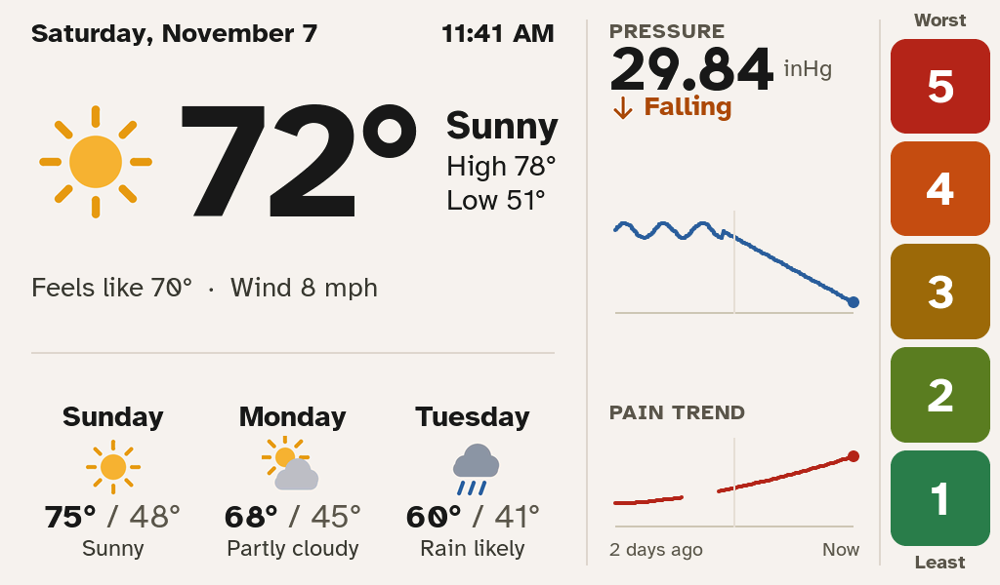
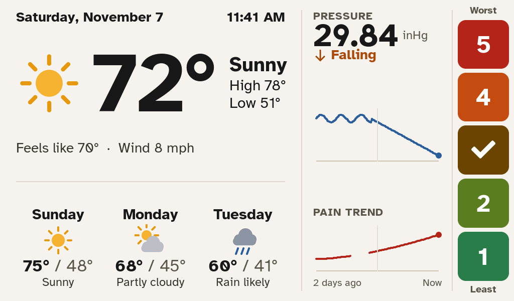
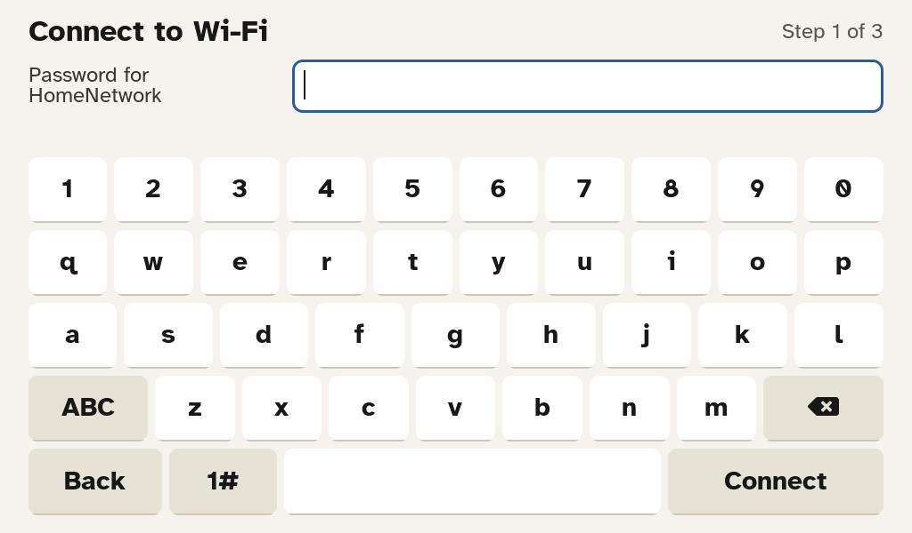
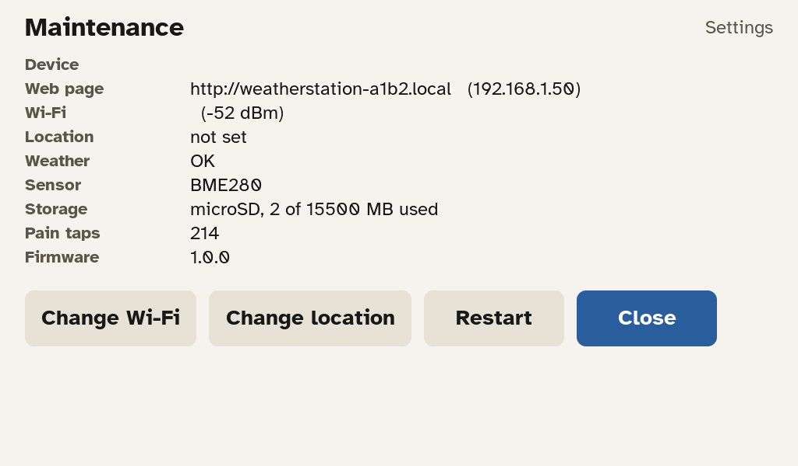
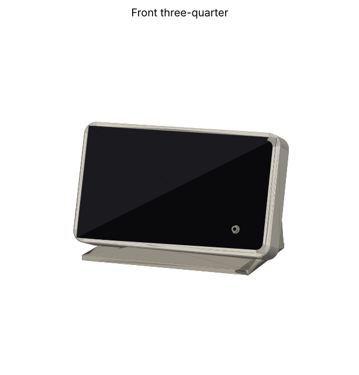
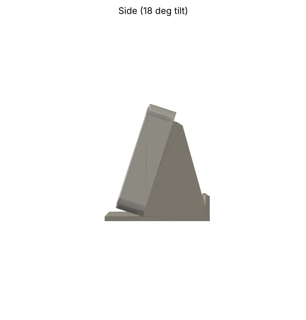
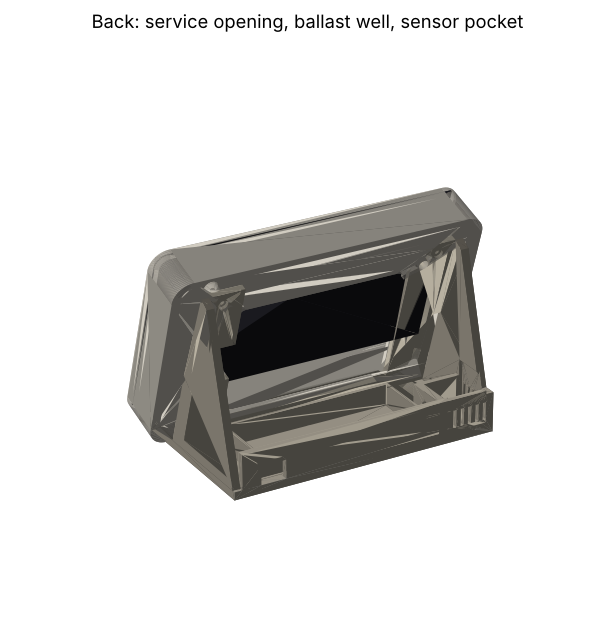

# Weather & Pain Station

A 7" tabletop weather display built for an elderly user. It needs no menus and only one
gesture: tap a number.



## Summary

- **Big, readable weather.** Current conditions and a 3-day forecast from Open-Meteo
  (free, no API key), in large Atkinson Hyperlegible type on a light, high-contrast screen.
- **Barometric pressure history.** A BME280 sensor logs pressure every 10 minutes, shown
  as a 48-hour graph with a rising or falling trend.
- **One-tap pain logging.** Five always-visible buttons (1 = least, 5 = worst). A tap logs
  the score and shows a check mark for a second. There are no screens to get lost in.
- **Forgiving statistics.** Mis-taps, bursts of repeated taps and irregular use are
  handled in the analysis, not by the user. The screen shows a smoothed pain trend under
  the pressure graph, and the web page correlates pain with pressure changes.
- **Hands-off maintenance.** A password-protected web page, over-the-air updates with
  automatic rollback, a fallback hotspot if Wi-Fi is lost, and dimming at sunset.
- **Printable case.** A tabletop stand at an 18° tilt holds the glass flush with the front,
  with a ballast well and a vented sensor pocket.

| Tap feedback | First-time setup | Maintenance (hold the date 10 s) |
|---|---|---|
|  |  |  |

| Case, front | Case, side | Case, back |
|---|---|---|
|  |  |  |

The screenshots are rendered on a PC from the real firmware UI code, using sample data
(see `firmware/test/host`).

**Hardware:** Waveshare ESP32-S3-Touch-LCD-7B (1024x600), a BME280, a microSD card and a
USB-C power supply. The parts list is in section 1 below.

## Repository layout

```
firmware/   PlatformIO project (Arduino-ESP32 3.3 + LVGL 8.3)
case/       Parametric CadQuery case: front tray + stand (STL/STEP in case/out)
tools/      analyze.py (re-run the analysis on a PC), font/icon generators
docs/       Screenshots rendered from the real UI code, case previews
```

Status: the firmware compiles, and its analysis code passes unit tests. Its screens
were rendered on a PC from the real UI code (see `docs/`). The case was checked for
collisions against Waveshare's STEP model. **None of it has run on real hardware yet.**
The checklist under "First power-on" covers what to verify.

---

## 1. Parts

| Part | Notes |
|---|---|
| Waveshare **ESP32-S3-Touch-LCD-7B** (Touch version) | Must be the **7B** (1024x600, dimmable). The plain "-7" won't fit the case or the code. |
| BME280 breakout, 3.3 V, I2C | A BMP280 also works (pressure only). |
| microSD card, 8-32 GB, FAT32 | Optional: without it, logs go to internal flash (about 3 MB, several years of data). |
| **90-degree (right-angle) USB-C cable**, 2 m, plus a 5 V 2 A USB adapter | The board's USB-C ports face sideways inside the case, so a straight plug won't fit. |
| 4 x M3 x 20 screws (pan or socket head) | Display to front tray. |
| 4 x M3 x 12 screws | Stand to tray (they self-tap into PLA/PETG). |
| 4 x 10 mm self-adhesive rubber feet | Stop it sliding when tapped. |
| Ballast: about 150-250 g of steel washers, coins or fishing weights | Goes in the stand's rear well. |
| Female-female jumper wires, about 15 cm | To extend Waveshare's HY2.0-to-DuPont cable to the sensor pocket. |

## 2. Wiring

BME280 to the board's **I2C** HY2.0 header (labelled on the board; it sits on the left
when you look at the screen from the front):

| Board I2C | BME280 |
|---|---|
| 3V3 | VIN / VCC |
| GND | GND |
| SDA (GPIO 8) | SDA |
| SCL (GPIO 9) | SCL |

The touch controller and IO expander share this bus. The BME280 can be at address
0x76 or 0x77; the firmware finds it automatically.

## 3. Build and flash

```bash
pip install platformio
cd firmware
pio run                      # build
pio run -t upload            # first flash over USB
pio device monitor           # serial log, 115200
```

Later updates can go over Wi-Fi/VPN from the web page (Data & updates → Firmware
update, upload `.pio/build/station/firmware.bin`), or with
`pio run -e station_ota -t upload` after setting the host and password in
`platformio.ini`. If a new firmware crashes within its first minute, the station rolls
back to the previous version on its own.

## 4. Print the case

`case/out/front_tray.stl` and `case/out/stand.stl` (STEP files are there too).
Edit the parameters at the top of `case/case.py` (tilt, wall, screw length...) and
re-run `python3 case.py` to regenerate them.

| Part | Orientation | Notes |
|---|---|---|
| front_tray | Back face down | No supports needed. 0.2 mm layers, 4 walls, 20 % infill. |
| stand | Base down | No supports needed. 4 walls, 25 % infill. |

PETG or PLA both work. The tray holds the glass flush on a 3 mm ledge, with 0.35 mm
clearance. If your printer runs tight, increase `CLEAR` in `case.py`.

## 5. Assembly

1. Put the SD card in, then plug the right-angle USB-C cable into the board's right-hand
   port, angled toward the back. Plug the HY2.0 cable into the I2C header.
2. Thread both cables out through the tray's rear opening (the USB cable goes out
   through the side slot), then lay the display face-down into the tray. The glass drops
   onto the ledge.
3. Screw the 4 x M3 x 20 screws through the back into the display frame. Snug them only,
   since they pull the glass onto the ledge.
4. Fix the BME280 in the stand's vented rear-left pocket (a dab of hot glue on the
   edge, not over the sensor) and run its wires into the stand.
5. Screw the stand to the tray with the 4 x M3 x 12 screws. Run the USB cable out through
   the notch in the stand's back wall.
6. Fill the ballast well, cover it with tape, and stick on the rubber feet.

The microSD card stays reachable through the rear openings.

## 6. First power-on (checklist)

On first boot it shows **Connect to Wi-Fi**. The steps are: pick the network and type
its password, search for the location by city or ZIP, then set a **maintenance
password** (8+ characters). The final screen shows the web address.

The code has not run on real hardware yet, so check these the first time:

- [ ] Picture is right-side up and the colours look right (blue pressure line, red pain line).
- [ ] Touch lands where you tap (tap "1" and the "1" button shows a check mark).
- [ ] The date, time and forecast match your phone.
- [ ] The web page loads at `http://<name>.local` or the IP, user `admin`.
- [ ] After 10 minutes, the web page Overview shows the sensor (BME280) with a recent reading.
- [ ] Brightness drops after sunset.
- [ ] Holding the date at the top for 10 seconds opens Maintenance, and it closes itself after 3 minutes.

If the picture or touch is mirrored or upside down, the panel timing and pins are in
`firmware/src/config.h` and the touch mapping is in `board.cpp` (`touch_read_cb`).
If the case's screw holes don't line up, your board is rotated relative to Waveshare's
model. Set `TABS` in `case/case.py` to the mirrored X values and re-export.

## 7. Day-to-day maintenance (remote)

The web page (user `admin`, maintenance password) has four tabs:

- **Overview**: weather and sensor status, storage, memory, and touch statistics (accepted taps vs. filtered glitches and palm touches).
- **History & analysis**: pressure and pain charts. Faded dots are taps judged likely mis-taps. Also daily values and how pain tracks pressure changes (3, 12 and 24 h, lags 0-48 h).
- **Settings**: device name, location, brightness, Wi-Fi, password, and analysis parameters.
- **Data & updates**: CSV downloads, firmware upload, restart.

If Wi-Fi is lost for 30 minutes, the station also starts its own hotspot (named after
the device, password = maintenance password). Someone on site can then reach the web
page at `http://192.168.4.1`. Meanwhile the screen keeps showing the last forecast with an
"Offline" note.

For more units, give each its own device name (it becomes its network name) and
location. Everything else is per-unit and independent.

## 8. How the pain analysis works

Raw taps are never edited. Every time the station draws the trend, it recomputes it
from all the raw taps:

1. Taps in a quick burst (within 1.5 h) share one vote, so 57 taps don't outweigh one.
2. A smooth trend is fitted through the taps (locally weighted, ±12 h).
3. A tap far from that trend is down-weighted, but only to the extent that nearby
   taps contradict it. "2, 2, 5" → the 5 gets near-zero weight. "5, 5, 5" → real.
   A lone tap on a quiet day keeps full weight, so occasional use isn't penalised.
4. The daily value is the average of the trend over the day, so every day counts once.

The one built-in trade-off: a genuine one-off spike that never repeats looks the same as
a mis-tap. `tools/analyze.py` reproduces this analysis exactly (verified to match the
device code) and accepts different parameters if you want to explore.

```bash
python3 tools/analyze.py pain.csv pressure.csv --utc-offset -7 --plot chart.png
```

## 9. Developer notes

- `firmware/test/test_pain.cpp`: analysis unit tests (`g++ -std=c++17 -I../src test_pain.cpp ../src/pain.cpp && ./a.out`).
- `firmware/test/host/build.sh`: renders the real screens to PNG on a PC (after one `pio run`), for checking layout changes without hardware.
- Fonts: Atkinson Hyperlegible (Braille Institute, SIL OFL), regenerated with `tools/gen_fonts.sh`; icons with `tools/gen_icons.py`.
- Board details (pins, timing, IO expander at 0x24, inverted backlight PWM) come from Waveshare's examples: github.com/waveshareteam/ESP32-S3-Touch-LCD-7B.
- Weather and geocoding come from Open-Meteo (free, no key). HTTPS certificates aren't pinned, because the data is public and pinning breaks when certificates rotate.
